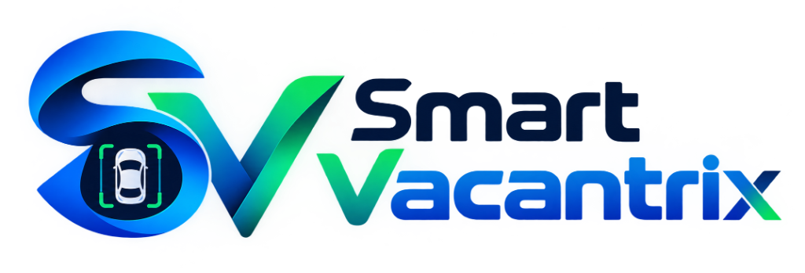

# 🅿️ Smart Vacantrix — Intelligent Parking Space Detection & Analytics Platform

A lightweight, enterprise-grade parking space occupancy detection and facility management platform built using pure **Python**, **OpenCV**, and a fully responsive **Flask Web Application** (zero Streamlit).



---

## 🌟 Key Features

1. **📊 Real-Time Operations Dashboard**:
   - 5 Live KPI Metric Cards: Total Spaces, Vacant Bays, Occupied Bays, Occupancy Rate, and Optimal Space guidance.
   - 24-Bay Interactive Slot Grid with real-time green (vacant) and red (occupied) visual indicators.
   - Hourly Occupancy Trend Line Graph powered by Chart.js.
   - Comprehensive Recent Detections & Vehicle Recognition audit log.

2. **📷 Photo Detection & Interactive Bay Mapping**:
   - Upload any parking lot photo (CCTV, drone aerial, perspective) or switch between Mall Lot and Drone View presets.
   - Interactive Bay Mapping: Left-click to add a bay, right-click to delete.
   - Multiple Vision Viewports: Annotated View, Edge Mask, Heatmap, and Raw Camera.
   - Dynamic Sensitivity & Bay Geometry sliders with instant visual feedback.

3. **📹 Live CCTV Stream & Video Analysis**:
   - Continuous 25-30 FPS OpenCV MJPEG video streaming (`live.mp4` / webcam / upload).
   - Real-time frame texture and occupancy analysis with live FPS and occupancy telemetry.

4. **🌐 3D Digital Twin Simulation Map**:
   - Interactive Three.js WebGL 3D simulation synchronized with live camera telemetry.
   - Real-time vehicle entry/exit simulation, capacity bar, and live operational comments.

5. **⚙️ General Parking Settings**:
   - Facility profile, operating hours, hourly rate ($/hr), and free grace period.
   - Camera parameters (target FPS, low-light contrast boost, auto-reconnect).
   - Occupancy alerts (85% nearly full alert) and physical entrance roadside LED board sync.

6. **📱 Fully Mobile Responsive**:
   - Native slide-out navigation drawer with smooth backdrop blur for phones and tablets.
   - Horizontal scrollable quick-action pill bar and touch-optimized controls.

---

## 🚀 Quick Start

### 1. Requirements
Only standard Python packages are required:
```bash
pip install -r requirements.txt
```
*(Dependencies: `opencv-python`, `numpy`, `flask`)*

### 2. Launch the Platform
```bash
python web_app.py
```
Open your browser at:
👉 **http://localhost:5000**

---

## 📁 Repository Structure

```
├── web_app.py                # Core Flask backend & OpenCV video streaming engine
├── parking.py                # Standalone OpenCV desktop utility
├── api.py                    # REST API routing & telemetry handlers
├── core/                     # Vision processing modules
├── data/
│   └── default_slots.json    # Calibrated parking bay geometry
├── static/
│   ├── logo_full.png         # Official Smart Vacantrix horizontal logo
│   ├── logo_icon.png         # 3D emblem icon & header brand
│   ├── favicon.png           # Browser favicon
│   ├── js/                   # 3D simulation engine & scripts
│   └── preloader_preview.jpg # Apple-style preloader 3D display preview
├── templates/
│   └── index.html            # Single-page web dashboard & mobile drawer
├── live.mp4                  # Sample CCTV continuous video feed
├── parking_lot.png           # Sample parking lot camera capture
└── requirements.txt          # Python dependencies
```

---

## 📄 License & Credits
Developed under the MIT License for **Smart Vacantrix**.
